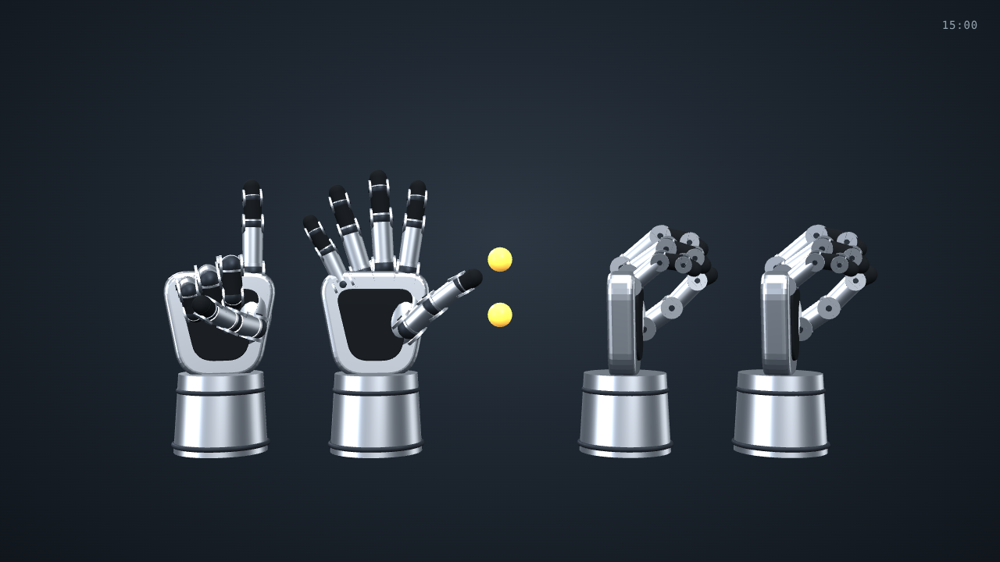
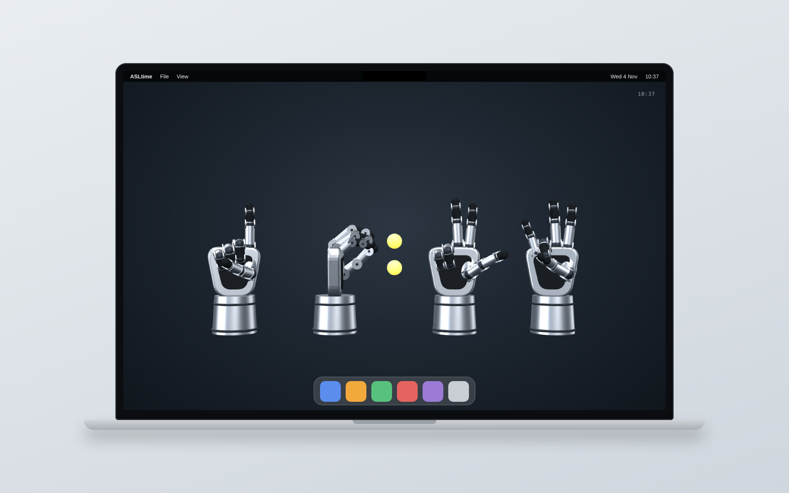
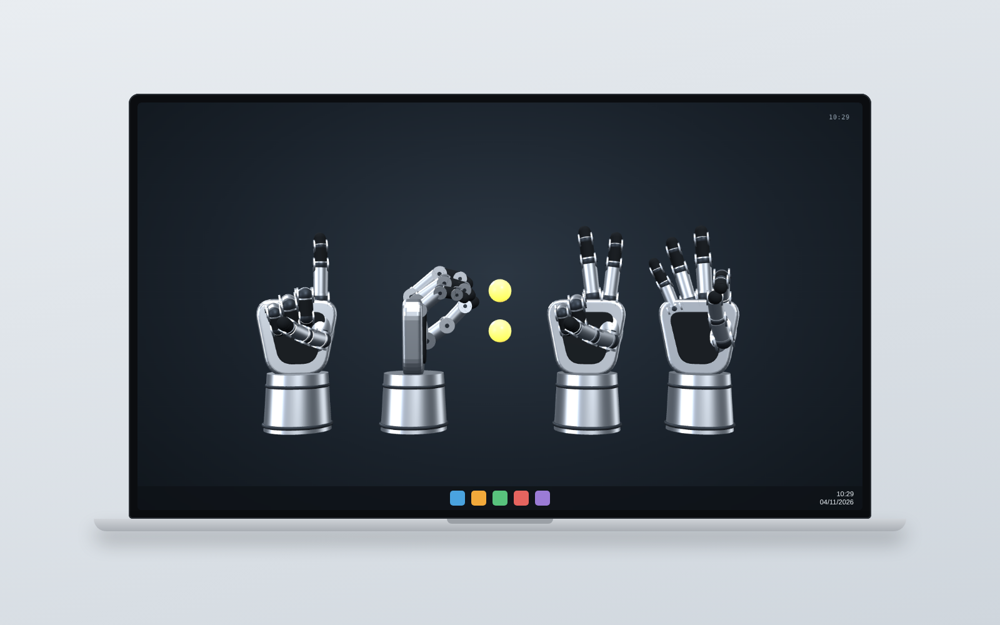

# ASLtime

A live 3D clock where four robotic hands tell the time in **American Sign Language** number signs. Two hands show the hours, two show the minutes, and glowing dots sit between them as the colon.

## Live demo

Enable GitHub Pages for this repo (Settings > Pages > Deploy from branch > `main` / root) and the clock will be live at `https://shravanamudala55.github.io/ASLtime/`.

## How to read it

Each hand shows one digit with one hand.

| Digit | Sign |
|------|------|
| 0 | Thumb and fingers curve into an "O" |
| 1 | Index finger up |
| 2 | Index and middle finger up (V) |
| 3 | Thumb, index and middle finger out |
| 4 | Four fingers up, thumb tucked |
| 5 | Open hand |
| 6 | Thumb touches the pinky fingertip |
| 7 | Thumb touches the ring fingertip |
| 8 | Thumb touches the middle fingertip |
| 9 | Thumb touches the index fingertip |

## Features

- Rigged robotic hands built with three.js, with real finger joints driven by forward kinematics
- Uses your system clock and follows your system 12 hour or 24 hour setting
- Works fully offline: one HTML file, no build step, no network requests
- Full screen layout with the cursor hidden, made for use as a desktop wallpaper or screensaver

## Run it

Open `index.html` in any modern browser.

## How it looks on a laptop

ASLtime fills the whole screen, so it works well as a live wallpaper or a screensaver. These mockups show it on a MacBook and on a Windows laptop (with 10:37 on the clock).

**MacBook**

**Windows laptop**

## Use it as a wallpaper or screensaver

These are free third-party apps that can show a web page behind your desktop. I have not tested them on every setup, so treat this as a starting point.

- **Windows:** Lively Wallpaper can use a local HTML file as a live wallpaper.
- **Mac:** Plash shows a web page as your desktop. WebViewScreenSaver does the same as a screensaver.

Lock screens on both systems only accept still images, so the live clock cannot go there.

## Credits

See [THIRD_PARTY.md](THIRD_PARTY.md) for the open source components used.

## License

MIT, see [LICENSE](LICENSE).
